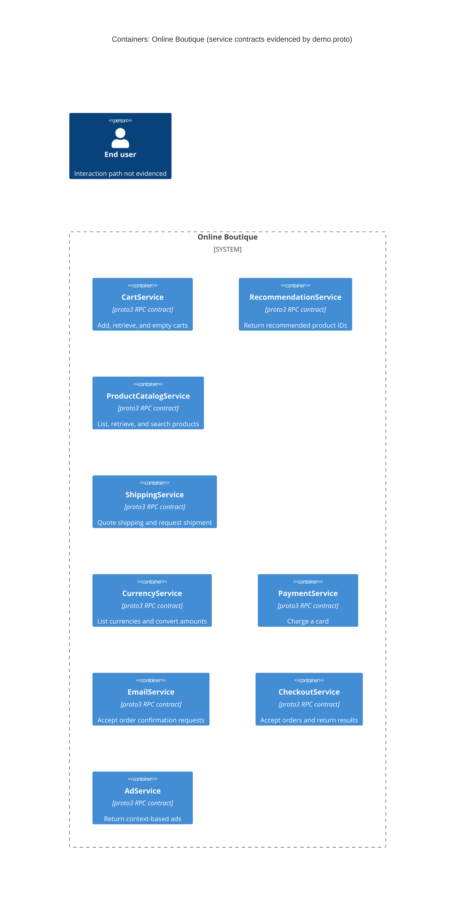

# Recovered architecture — run A

## Agent

Codex (GPT-6).

## Files read

- `prompts/1-recover-architecture.md`
- `system/online-boutique/protos/demo.proto`

## Containers table

The file declares service contracts. Whether each contract has a separately deployed container, and its implementation language, are not evidenced in the provided files. The table uses each declared service as a candidate container.

| Name | Technology/language | Responsibility | Evidence |
| --- | --- | --- | --- |
| CartService | proto3 RPC contract; implementation not evidenced | Add items, retrieve a user's cart, and empty it. | `system/online-boutique/protos/demo.proto` (`service CartService`; `AddItem`, `GetCart`, `EmptyCart`) |
| RecommendationService | proto3 RPC contract; implementation not evidenced | Return recommended product IDs. | `system/online-boutique/protos/demo.proto` (`service RecommendationService`; `ListRecommendations`) |
| ProductCatalogService | proto3 RPC contract; implementation not evidenced | List, retrieve, and search products. | `system/online-boutique/protos/demo.proto` (`service ProductCatalogService`; `ListProducts`, `GetProduct`, `SearchProducts`) |
| ShippingService | proto3 RPC contract; implementation not evidenced | Quote shipping cost and request shipment, returning a tracking ID. | `system/online-boutique/protos/demo.proto` (`service ShippingService`; `GetQuote`, `ShipOrder`; `ShipOrderResponse.tracking_id`) |
| CurrencyService | proto3 RPC contract; implementation not evidenced | List supported currencies and convert amounts. | `system/online-boutique/protos/demo.proto` (`service CurrencyService`; `GetSupportedCurrencies`, `Convert`) |
| PaymentService | proto3 RPC contract; implementation not evidenced | Charge a card and return a transaction ID. | `system/online-boutique/protos/demo.proto` (`service PaymentService`; `Charge`; `ChargeResponse.transaction_id`) |
| EmailService | proto3 RPC contract; implementation not evidenced | Accept an order confirmation request addressed to an email. | `system/online-boutique/protos/demo.proto` (`service EmailService`; `SendOrderConfirmation`; `SendOrderConfirmationRequest.email`) |
| CheckoutService | proto3 RPC contract; implementation not evidenced | Accept an order request and return an order result. | `system/online-boutique/protos/demo.proto` (`service CheckoutService`; `PlaceOrder`; `PlaceOrderResponse.order`) |
| AdService | proto3 RPC contract; implementation not evidenced | Return ads for context keywords. | `system/online-boutique/protos/demo.proto` (`service AdService`; `GetAds`; `AdRequest.context_keys`) |

## Dependencies table

No caller → callee runtime dependency is evidenced in `system/online-boutique/protos/demo.proto`. Its RPC declarations define callable interfaces but do not identify callers or establish a runtime transport.

## Mermaid diagram

## Gaps

- Actual deployments, implementation languages, and whether these interfaces map one-to-one to containers: Not evidenced in the provided files. Service source files and deployment manifests would settle this.
- Caller → callee dependencies, runtime protocols, and the end user's entry point: Not evidenced in the provided files. Service call sites and deployment configuration would settle these.
- Data stores, message brokers, and external systems: Not evidenced in the provided files. Service source files and deployment configuration would settle these.
