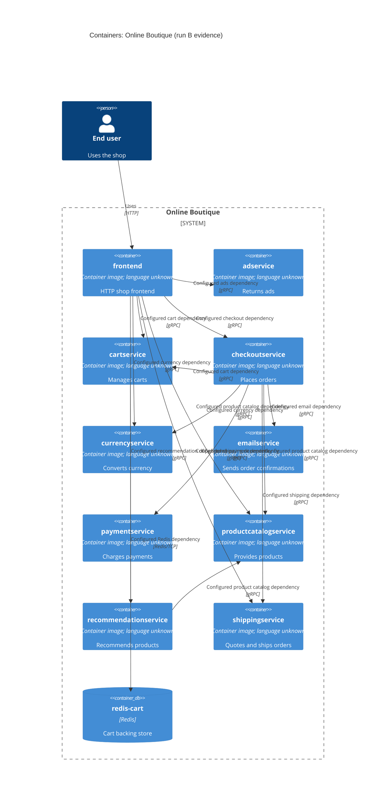

# Recovered architecture — run B

## Agent

Codex (GPT-6).

## Files read

- `prompts/1-recover-architecture.md` (task instructions)
- `system/online-boutique/protos/demo.proto`
- `system/online-boutique/kubernetes-manifests/adservice.yaml`
- `system/online-boutique/kubernetes-manifests/cartservice.yaml`
- `system/online-boutique/kubernetes-manifests/checkoutservice.yaml`
- `system/online-boutique/kubernetes-manifests/currencyservice.yaml`
- `system/online-boutique/kubernetes-manifests/emailservice.yaml`
- `system/online-boutique/kubernetes-manifests/frontend.yaml`
- `system/online-boutique/kubernetes-manifests/kustomization.yaml`
- `system/online-boutique/kubernetes-manifests/loadgenerator.yaml`
- `system/online-boutique/kubernetes-manifests/paymentservice.yaml`
- `system/online-boutique/kubernetes-manifests/productcatalogservice.yaml`
- `system/online-boutique/kubernetes-manifests/README.md`
- `system/online-boutique/kubernetes-manifests/recommendationservice.yaml`
- `system/online-boutique/kubernetes-manifests/shippingservice.yaml`

## Containers table

The manifests identify container images, but do not establish the services' implementation languages. All listed service manifests are included by `system/online-boutique/kubernetes-manifests/kustomization.yaml (resources)`; `redis-cart` is deployed within `cartservice.yaml`.

| Container | Technology/language | Responsibility | Evidence |
|---|---|---|---|
| `frontend` | `frontend` image; language not evidenced | HTTP shop frontend [Inferred from name and exposed HTTP service] | `system/online-boutique/kubernetes-manifests/frontend.yaml (Deployment/frontend, Service/frontend-external, port http)` |
| `adservice` | `adservice` image; language not evidenced | Return ads for context keys | `system/online-boutique/kubernetes-manifests/adservice.yaml (Deployment/adservice)`; `system/online-boutique/protos/demo.proto (AdService.GetAds)` |
| `cartservice` | `cartservice` image; language not evidenced | Add, retrieve, and empty a user's cart | `system/online-boutique/kubernetes-manifests/cartservice.yaml (Deployment/cartservice)`; `system/online-boutique/protos/demo.proto (CartService)` |
| `checkoutservice` | `checkoutservice` image; language not evidenced | Place orders | `system/online-boutique/kubernetes-manifests/checkoutservice.yaml (Deployment/checkoutservice)`; `system/online-boutique/protos/demo.proto (CheckoutService.PlaceOrder)` |
| `currencyservice` | `currencyservice` image; language not evidenced | List supported currencies and convert amounts | `system/online-boutique/kubernetes-manifests/currencyservice.yaml (Deployment/currencyservice)`; `system/online-boutique/protos/demo.proto (CurrencyService)` |
| `emailservice` | `emailservice` image; language not evidenced | Send order confirmations | `system/online-boutique/kubernetes-manifests/emailservice.yaml (Deployment/emailservice)`; `system/online-boutique/protos/demo.proto (EmailService.SendOrderConfirmation)` |
| `paymentservice` | `paymentservice` image; language not evidenced | Charge a payment | `system/online-boutique/kubernetes-manifests/paymentservice.yaml (Deployment/paymentservice)`; `system/online-boutique/protos/demo.proto (PaymentService.Charge)` |
| `productcatalogservice` | `productcatalogservice` image; language not evidenced | List, retrieve, and search products | `system/online-boutique/kubernetes-manifests/productcatalogservice.yaml (Deployment/productcatalogservice)`; `system/online-boutique/protos/demo.proto (ProductCatalogService)` |
| `recommendationservice` | `recommendationservice` image; language not evidenced | Return product recommendations | `system/online-boutique/kubernetes-manifests/recommendationservice.yaml (Deployment/recommendationservice)`; `system/online-boutique/protos/demo.proto (RecommendationService.ListRecommendations)` |
| `shippingservice` | `shippingservice` image; language not evidenced | Quote shipping and ship orders | `system/online-boutique/kubernetes-manifests/shippingservice.yaml (Deployment/shippingservice)`; `system/online-boutique/protos/demo.proto (ShippingService)` |
| `redis-cart` | `redis:alpine`; Redis | Cart service backing store [Inferred from `REDIS_ADDR`] | `system/online-boutique/kubernetes-manifests/cartservice.yaml (REDIS_ADDR, Deployment/redis-cart, image: redis:alpine)` |

## Dependencies table

Service address variables establish configured caller-to-callee dependencies; the allowed files do not show which calls execute on a particular request. gRPC is supported by the named Service ports and the RPC definitions in `system/online-boutique/protos/demo.proto`.

| Caller → callee | Protocol | Evidence |
|---|---|---|
| End user → `frontend` | HTTP | `system/online-boutique/kubernetes-manifests/frontend.yaml (Service/frontend-external, type: LoadBalancer, port name: http)` |
| `frontend` → `productcatalogservice` | gRPC | `system/online-boutique/kubernetes-manifests/frontend.yaml (PRODUCT_CATALOG_SERVICE_ADDR)` |
| `frontend` → `currencyservice` | gRPC | `system/online-boutique/kubernetes-manifests/frontend.yaml (CURRENCY_SERVICE_ADDR)` |
| `frontend` → `cartservice` | gRPC | `system/online-boutique/kubernetes-manifests/frontend.yaml (CART_SERVICE_ADDR)` |
| `frontend` → `recommendationservice` | gRPC | `system/online-boutique/kubernetes-manifests/frontend.yaml (RECOMMENDATION_SERVICE_ADDR)` |
| `frontend` → `shippingservice` | gRPC | `system/online-boutique/kubernetes-manifests/frontend.yaml (SHIPPING_SERVICE_ADDR)` |
| `frontend` → `checkoutservice` | gRPC | `system/online-boutique/kubernetes-manifests/frontend.yaml (CHECKOUT_SERVICE_ADDR)` |
| `frontend` → `adservice` | gRPC | `system/online-boutique/kubernetes-manifests/frontend.yaml (AD_SERVICE_ADDR)` |
| `checkoutservice` → `productcatalogservice` | gRPC | `system/online-boutique/kubernetes-manifests/checkoutservice.yaml (PRODUCT_CATALOG_SERVICE_ADDR)` |
| `checkoutservice` → `shippingservice` | gRPC | `system/online-boutique/kubernetes-manifests/checkoutservice.yaml (SHIPPING_SERVICE_ADDR)` |
| `checkoutservice` → `paymentservice` | gRPC | `system/online-boutique/kubernetes-manifests/checkoutservice.yaml (PAYMENT_SERVICE_ADDR)` |
| `checkoutservice` → `emailservice` | gRPC | `system/online-boutique/kubernetes-manifests/checkoutservice.yaml (EMAIL_SERVICE_ADDR)` |
| `checkoutservice` → `currencyservice` | gRPC | `system/online-boutique/kubernetes-manifests/checkoutservice.yaml (CURRENCY_SERVICE_ADDR)` |
| `checkoutservice` → `cartservice` | gRPC | `system/online-boutique/kubernetes-manifests/checkoutservice.yaml (CART_SERVICE_ADDR)` |
| `recommendationservice` → `productcatalogservice` | gRPC | `system/online-boutique/kubernetes-manifests/recommendationservice.yaml (PRODUCT_CATALOG_SERVICE_ADDR)` |
| `cartservice` → `redis-cart` | Redis/TCP [Inferred] | `system/online-boutique/kubernetes-manifests/cartservice.yaml (REDIS_ADDR=redis-cart:6379, Service/redis-cart port name: tcp-redis)` |

## Mermaid diagram

## Gaps

- Implementation languages and exact request-time call paths: not evidenced in the provided files. The corresponding service source files or Dockerfiles would settle these.
- `SHOPPING_ASSISTANT_SERVICE_ADDR` names `shoppingassistantservice:80`, but no active manifest for that service appears in `kustomization.yaml`; whether it runs in this configuration is not evidenced in the provided files. The commented `kustomize/components/shopping-assistant` component or deployment configuration would settle this.
- `loadgenerator.yaml` defines a load generator that targets `frontend:80`, but `kustomization.yaml` comments it out. Whether it runs via the separately mentioned Skaffold module is not evidenced in the provided files; `system/online-boutique/skaffold.yaml` would settle this.
- Whether payment or email calls reach external providers is not evidenced in the provided files. The `paymentservice` and `emailservice` source files would settle this.
- Redis durability beyond the pod's `emptyDir` volume is not evidenced in the provided files; an active storage configuration or the relevant deployment overlay would settle this.
